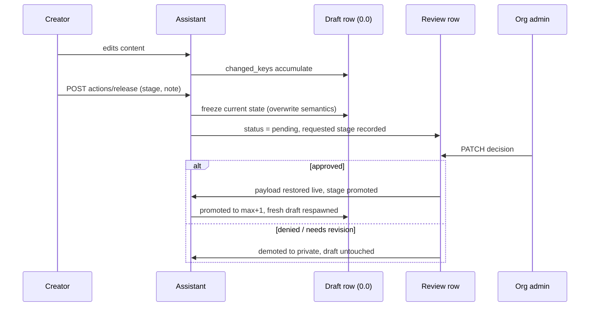

# Assistant Review Workflow

Public visibility of an assistant is an editorial decision. This page describes the versioned review workflow that enforces it: every assistant carries a mutable working draft, submitting freezes that state, and an organization admin's approval is what makes content public. Three collaborators share the work:

| Collaborator | Responsibility |
|---|---|
| `App\Services\Assistant\AssistantVersionService` | Versioned state: the working draft, the frozen payload, promotion and rollback |
| `App\Services\Assistant\AssistantService::release()` | The `actions/release` submission flow and stage transitions |
| `App\Services\Assistant\AssistantReviewService` | Decisions (approve / deny / request revision) and their side effects |

## The version model

Every assistant owns rows in `assistant_versions`:

| Column | Meaning |
|---|---|
| `version` | `0.0` is the mutable **working draft**; `1.0`, `2.0`, … are published versions (append-only, `decimal:1`) |
| `payload` | Full serialized state at freeze time — scalar attributes plus references (ids) to the child rows that shape the assistant. Internal to the versioning machinery, never exposed through the API |
| `changed_keys` | The delta between the published state and the working draft — what a reviewer sees as "changed since last publish" |
| `text` | The creator's release note; the review queue's detail shows it as the submission note |

Two listeners maintain the draft: `AssistantCreateInitialVersion` seeds the draft row at version `0.0` on `AssistantCreatedEvent`, and `AssistantUpdatedVersion` accumulates `changed_keys` on it for every content edit. Edits never create version rows — the draft is the only thing that moves until an approval promotes it.

The payload references child rows (settings, tags, tools, prompts, attachments, avatar) by id instead of duplicating them, so restoring does not trickle into the other models. Knowledge attachments are the one exception: they are recorded in the payload but never restored — removing rows would cascade into stored-file deletion and break restoring older versions again (see [Assistant Knowledge](../675-AssistantKnowledge/100-Knowledge-Tool.md)).

## Life of a submission

`release()` distinguishes what needs review from what does not:

- **Draft / private targets** are freely settable and apply immediately; any pending publication request is dropped.
- **Downward or same-level public moves** (e.g. federated → organizational) reduce exposure and apply immediately too.
- **Upward moves into a public tier** (private → organizational, or any escalation between public tiers) **always require a fresh review** — an earlier approval never takes effect by itself. An approved review only represents a current state while the assistant is public; once it has fallen back to private, the record is history (surfaced as "outdated" in the creator's submission list). The desired stage is recorded on `requested_release_stage`, the review (re)opens as pending, and the assistant stays at its current stage until an admin decides.

**Editing a released assistant unpublishes it** (`UnpublishReleasedAssistantOnEdit`): the first content edit of a public assistant demotes it to private, and the stage-change cascade tears down its non-denied review. The change never reaches users — the creator must resubmit the changed state for review before it goes live again. The edit still journals on the working draft (`changed_keys`), so the resubmission freezes the full delta. The builder warns about this before the first change is saved.

Every submit **freezes** the current state onto the working draft — overwrite semantics, including changes to an already publicly released assistant. The review therefore always judges the exact submitted state, and post-submit edits by the creator unpublish the assistant again (they are never live unreviewed). A submit without a note keeps the previous one.

A remix deliberately starts a fresh version history: the created event seeds the clone's own draft, and the source's published numbers stay behind — a remix is a new assistant, not a continuation of the lineage.

## Decisions and re-decisions

Reviews are decided through `PATCH /assistant-reviews/{id}`. The controller captures the pre-update status and reason and delegates to `AssistantReviewService::applyStatusTransition()`, which fires promote/demote side effects **only on genuine transitions**. Deciding an already decided review is therefore supported — the admin surface always offers all three options, with the previous decision shown above them:

| Transition | Effect |
|---|---|
| → `approved` (from anything else) | `promoteDraft()`: the draft becomes `max + 1`, its payload is restored onto the live assistant, `promoteRequested()` applies the recorded stage. A fresh draft respawns from the published state. The previous denial reason is cleared — the approval supersedes it |
| → `denied` (from a non-denial) | `revokeRelease()`: the assistant is demoted to **private**. A denied review permanently blocks resubmission (see below). Reviewer, timestamp and reason are recorded |
| → `needs_revision` (from a non-denial) | Same demotion to private, but the creator may revise and resubmit — a resubmission reopens the review fresh, judged on its own merits |
| between the denial variants (`denied` ↔ `needs_revision`) | No promote/demote fires: a switch to `needs_revision` **lifts the denial** (nothing published, resubmission re-allowed), a switch to `denied` blocks it again. The decision is still recorded |
| `denied` → `approved` | Re-approval: publishes the frozen submission as a new version and unblocks the creator. The approval never takes effect by itself — publishing afterwards always requires a fresh release request and review |
| same → same | Recorded only when the reason changed; otherwise a no-op |

Because denial is the one blocking state, the release request validator (`ReleaseAssistantRequest`) rejects upward releases with a 422 while the review is `denied` — an admin must first lift it (request revision) or re-approve. Both paths are covered by feature tests (`AssistantReviewTest`).

## Decision history

The review row also carries a `history` JSON column (`AssistantReviewHistory`): one append-only entry per decision that changes the status or the reason (status, reason, timestamp), appended inside the same transaction as the decision itself. That includes the promote/demote transitions as well as the switches between the denial variants and re-decisions with a new comment; an unchanged re-decision is a no-op. Reopening a review — resubmission, rollback — resets `status`/`reason` but never touches the history, so an admin always sees the previous rounds' decisions and their comments. It carries no reviewer names, so it is exposed on the `assistant-reviews` resource to every viewer allowed to see the review; the admin detail renders it under the change history.## Rollback

`POST /assistants/{id}/actions/rollback` restores an earlier published version. It is an editorial decision over content, so the policy is the organization's admins (`AssistantPolicy::rollback`) — the same tier that approves reviews. Which of two paths runs depends on one question: can users currently see the assistant?

**Public assistant, or a review pending → the rollback is itself a submission.** The target version's payload is frozen onto the working draft (note: "Rollback to version {n}", `changed_keys` = the diff between live and target), the review is reset to pending, and `requested_release_stage` is set to the current stage so approval re-publishes to the same visibility. Nothing changes for users until an admin approves — and approval appends a **new** version number carrying the restored content, rather than rewriting history.

**Private assistant with nothing pending → immediate and destructive.** Every version above the target is deleted, the target's payload is restored onto the live assistant, and the draft respawns from the restored state. Earlier decision records stay untouched. This path also doubles as "reset to baseline": rolling back to the newest published version discards unapproved working changes. The admin UI does not offer the button on that row (it is the live baseline); the API keeps the capability.

## Endpoint surface

| Endpoint | Purpose |
|---|---|
| `POST /assistants/{id}/actions/release` | Submit: freeze state, request a stage (creator only) |
| `POST /assistants/{id}/actions/rollback` | Restore an earlier published version (org admin) |
| `PATCH /assistant-reviews/{id}` | Decide: approve / deny / needs_revision (org admin of the assistant's organization) |
| `GET /assistant-reviews?filter[status]=…` | The review queue. `indexQuery` scopes to the user's own submissions plus their organizations' — never another org's |
| `GET /assistant-reviews/actions/permissions` | Class-level `updateAny` probe in the action-links ALLOWED/DENIED vocabulary. Drives admin-surface visibility only; the per-review policies stay the security boundary |

Stage changes that actually apply dispatch `AssistantReleaseStageChangedEvent`, which downstream surfaces (visibility filters, the store, federation) listen for.
